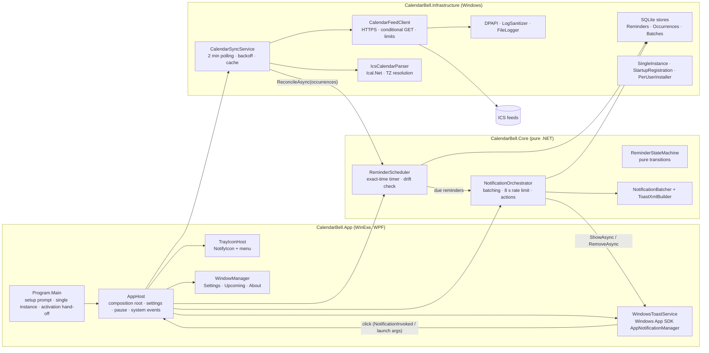

# CalendarBell architecture

## Components



* **Core** has no UI or Windows dependency. Every time-dependent class takes a `TimeProvider`; tests drive it with
  `FakeTimeProvider`. (The spec's `IClock` is `TimeProvider`.)
* **Infrastructure** targets `net10.0-windows` (DPAPI, registry, Task Scheduler COM, named pipes) but not the
  Windows App SDK, so test hosts never load it.
* **App** is the only project referencing the Windows App SDK (`Microsoft.WindowsAppSDK.Foundation` 2.7.0,
  unpackaged, self-contained). Toast XML is produced in Core and only *shown* here.

## Key decisions

| Decision | Why |
|---|---|
| Resident WPF `WinExe` with a tray icon, never a Windows Service | Services run in session 0 and cannot show interactive notifications. `WinExe` never opens a console. |
| Sync and scheduling are separate | Polling every 2 min would make reminders up to 2 min late. The scheduler arms one timer for the earliest due instant and fires at that instant (±timer resolution). |
| Pure `ReminderStateMachine` | All rules (absolute snooze targets, 2 s margin, late/"starting now"/expired windows, start-time changes) are pure functions with explicit "now", unit-tested exhaustively. |
| Absolute snooze implemented by the app | Windows' system snooze is relative to the click. CalendarBell uses an app-handled `Snooze` button with a selection input (`10`/`5`/`0` minutes before start) and resolves the target against each occurrence's own start. |
| One toast per batch, ≤ 1 new toast / 8 s | Simultaneous reminders (±1 s) are coalesced; same start (±60 s) → group toast with group Snooze/Dismiss; different starts → summary with *View reminders* / *Dismiss all*. Everything queued when a slot opens becomes one toast, so "At start" never waits behind other toasts. |
| Batch identity persisted | Toast arguments carry only `action` and a 12-hex batch id (`action=snooze&b=…`); members are looked up in SQLite, so clicks work after a restart or when Windows relaunches the app. |
| At-most-once delivery | A phase is persisted as sent *before* the toast is handed to Windows. A crash between both loses at most one toast; it never duplicates. Start-up reconciliation removes toasts whose occurrences no longer need attention. |
| Occurrence identity | `OccurrenceKey = SHA-256(CalendarId, UID, RECURRENCE-ID)` → independent of the current start time (moves keep identity), different per calendar (same UID in two calendars is two occurrences), and opaque (no UID in logs or toast arguments). |
| Start-time change = new temporal revision | A moved meeting gets a new reminder (even after Dismiss). Title/end/availability changes keep the state (no re-alert for cosmetic edits). |
| Feed failures keep the cache | Network errors, HTTP errors, 200 with HTML or truncated ICS never delete data. Only a complete valid feed can cancel occurrences (inside the expansion window). Data older than 24 h is "stale": its reminders are held (not fired, not consumed). |
| TZID resolution never falls back to UTC | IANA → Windows id → Windows display name → the calendar's own VTIMEZONE rules matched against system zones → `(UTC±hh:mm)` prefix → local zone with a warning. Ical.Net's default maps Outlook display-name TZIDs to UTC. |
| DPAPI (CurrentUser + app entropy) for URLs | A published ICS link is a secret. It exists in clear text only in memory while fetching or editing. |
| SQLite, WAL, versioned schema | One DB per user. A damaged DB is never deleted automatically: a copy is preserved and the user can explicitly reset (calendars are restored from an encrypted backup file). |
| Single instance: `Local\` mutex + ACL'd named pipe | Scoped by user SID and data folder. Second launches forward `open-settings` / `open-upcoming` / `notification-action` / `exit` and exit without UI. |
| Task Scheduler logon task, HKCU Run fallback | `InteractiveToken`, least privilege, no execution time limit, runs the EXE directly with `--background`. Only one mechanism is registered at a time. |
| Built-in per-user installer | Inno Setup is optional (source in `installer/`); the app installs itself from the ZIP into `%LOCALAPPDATA%\Programs\CalendarBell` without admin rights and registers an *Installed apps* entry. |

## Windows constraints (by design, not bugs)

* Windows controls toast layout, position, stacking, banner duration and the X button. The app cannot detect a click
  on X; it never re-sends a phase because of that.
* `scenario="reminder"` keeps the toast on screen until acted upon (when banners are allowed).
* Do not disturb / Focus and per-app notification settings are respected; the app only shows a hint banner.
* Elevated processes cannot show app notifications; the app never runs elevated and warns if it is.
* Timers do not run while the PC sleeps; on resume (and every 60 s) the scheduler re-evaluates: unsent reminders
  for meetings not yet started fire once ("Meeting in 7 min"), reminders ≥ 60 s after start expire silently.
* Freshness depends on the provider's publication delay, HTTP caches and the 2-minute poll.

## Action flows

**Toast click while CalendarBell runs** — Windows calls the COM activator registered by
`AppNotificationManager.Register()` in the running process → `NotificationInvoked` (background thread) →
`AppHost.HandleActivationAsync` → `ToastArguments.Parse` (strict whitelist) → `NotificationOrchestrator.HandleActionAsync`:

* `snooze` + `snoozeTarget` → `ReminderScheduler.SnoozeAsync(members, m, NextFutureFallback)` → toast removed.
* `dismiss` → `DismissAsync(members)` → toast removed.
* `open` / `view` → *Upcoming reminders* filtered to the members (the only action that opens a window).
* `test-*` → logged only; never touches real reminders.

**Toast click while CalendarBell is not running** — COM starts `CalendarBell.exe ----AppNotificationActivated:` →
it becomes the resident instance (no window) → after `Register()`, `AppInstance.GetActivatedEventArgs()` returns the
click → processed once services are ready.

**Second launch / start-up race** — the secondary process forwards the request (or the activation it received)
through the named pipe and exits.

## Reminder state model

```text
Pending ──T−15 (or late, before start+60 s)──▶ Notified ──Snooze(m)──▶ Snoozed(start−m) ──fires──▶ Notified …
   │                                             │                         │
   │                                             └──Dismiss──▶ Dismissed ◀──┘
   ├──start+60 s without delivery──▶ Expired (silently consumed)
   ├──cancelled / removed from feed──▶ Cancelled (toast retracted)
   └──start time changed (any state)──▶ Pending (new revision)
```

Persisted per occurrence (`Reminders` table): `calendar_id`, `occurrence_key`, `fingerprint`, `event_start_utc`,
`initial_due_utc`, `initial_sent`, `snoozed_until_utc`, `snooze_minutes`, `dismissed`, `cancelled`,
`last_notified_utc`, `last_toast_tag`, `last_toast_group`, `state_version` (UTC ticks).

## Storage layout (`%LOCALAPPDATA%\CalendarBell`)

| File | Content |
|---|---|
| `calendarbell.db` (+ `-wal`, `-shm`) | `Calendars` (name, DPAPI URL, enabled), `SyncState` (ETag, Last-Modified, last success, backoff), `OccurrencesCache` (start, end, availability, cancelled, title only when Privacy mode is off), `Reminders`, `ToastBatches`, `SchemaMigrations`. |
| `calendars.backup.json` (+ `.bak`) | Calendar list with DPAPI ciphertext only (restore after a storage reset). |
| `settings.json` (+ `.bak`) | Non-sensitive preferences, pause end, window positions. Written atomically. |
| `logs\calendarbell*.log` | Redacted rolling log. |

Overrides for development and tests: `CALENDARBELL_DATA_DIR`, `CALENDARBELL_ALLOW_HTTP_LOCALHOST=1`, or a
`CalendarBell.dev.json` next to the EXE (`{"dataDirectory": "...", "allowHttpLocalhost": true}`) — needed because
Windows relaunches the app for a click without the developer's environment. The installer never copies that file.

## Command line

| Argument | Meaning |
|---|---|
| *(none)* | Start (or bring Settings forward if already running). Outside the install folder: offer to install. |
| `--background` | Start silently (sign-in task). |
| `--settings`, `--upcoming` | Open that window (in the running instance). |
| `--install [--quiet]` | Per-user install from the current folder. |
| `--uninstall [--quiet] [--keep-files]` | Uninstall (`--keep-files`: cleanup only, used by the Inno Setup uninstaller). |
| `--no-install-prompt` | Run from any folder without installing. |
| `----AppNotificationActivated:` | Added by Windows when a toast click launches the app. |
